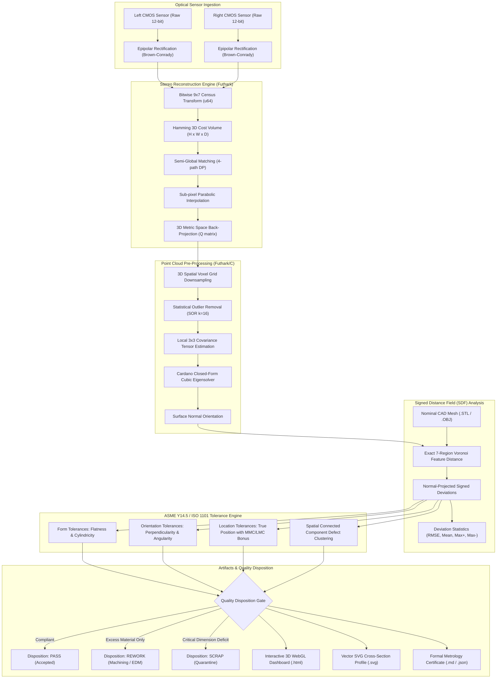

# Caliper

[](https://github.com/Aneesh495/caliper/actions/workflows/ci.yml)
[](LICENSE)
[](https://futhark-lang.org)
[](https://www.python.org)
[](https://www.asme.org)

**Caliper** is a high-throughput computational metrology, 3D optical inspection, and ASME Y14.5 / ISO 1101 Geometric Dimensioning & Tolerancing (GD&T) engine. Built with pure functional data-parallel **Futhark** kernels compiled to SIMD and GPU hardware, wrapped by a zero-overhead **C99** host bridge, and orchestrated by a high-level **Python** metrology SDK.

Caliper processes raw optical sensor imagery, back-projects dense metric point clouds, evaluates exact 7-region Voronoi Signed Distance Fields against reference CAD surfaces, audits geometric form and location tolerances with Maximum Material Condition (MMC) bonus tolerances, and clusters defect morphologies into deterministic quality dispositions (**PASS**, **REWORK**, **SCRAP**).

---

## Architecture Overview



---

## Key Technical Innovations

### 1. Pure Functional Data-Parallelism (`src/futhark/`)
All computationally heavy metrology routines are implemented in Futhark, guaranteeing deterministic memory footprints, zero data races, and automatic compiler vectorization (ARM NEON, AVX2, OpenCL, Apple Metal, and NVIDIA CUDA).
- `math.fut`: 3D vector algebra, Cardano closed-form cubic symmetric eigensolver, and 6x6 Cholesky linear solver.
- `calib.fut`: Brown-Conrady 8-parameter optical distortion with 5-iteration Newton-Raphson contraction inversion.
- `census.fut`: Bitwise $9 \times 7$ Census transform (`u64`) with population-count Hamming cost volume.
- `sgm.fut`: Semi-Global Matching dynamic programming along 4 paths with sub-pixel parabolic peak fitting.
- `filter.fut`: Voxel grid hashing, Statistical Outlier Removal (SOR), and normal-aligned bilateral smoothing.
- `normals.fut`: Local covariance tensor eigen-decomposition and sensor viewpoint normal alignment.
- `mesh.fut`: Watertight volume computation via Gauss's Divergence Theorem: $V = \frac{1}{6} \sum \mathbf{v}_0 \cdot (\mathbf{v}_1 \times \mathbf{v}_2)$.
- `distance.fut`: Exact 7-region Voronoi feature point-to-triangle distance classification.
- `icp.fut`: Point-to-plane ICP alignment with linearized normal equations and Levenberg-Marquardt damping.
- `fit.fut`: Orthogonal Distance Regression (ODR) plane, sphere, and cylinder fitting.
- `gdt.fut`: ASME Y14.5 / ISO 1101 Flatness, Cylindricity, Circularity, Perpendicularity, and True Position with MMC/LMC bonus tolerances.
- `defects.fut`: Spatial connected-component defect clustering and morphological classification (Flash, Burr, Void, Chatter, Warpage).

### 2. Zero-Copy C99 Native Bridge (`src/c/`)
- `caliper_io.c`: High-throughput binary and ASCII geometry parsers for Little-Endian Binary STL, ASCII PLY (with normals, signed deviations, and vertex colors), and Wavefront OBJ.
- `caliper_bridge.c`: Memory-mapped C interface linking Python runtimes to vectorized Futhark binaries without buffer copying.
- `caliper_main.c`: Standalone native CLI binary (`bin/caliper-cli`) with subcommands `inspect`, `gdt`, `info`, and `version`.

### 3. Comprehensive Metrology SDK & Reporting (`caliper/`)
- `caliper.geometry`: `PointCloud` and `TriangleMesh` models supporting SOR filtering, normal estimation, surface area, and watertight volume.
- `caliper.gdt_rules`: Declarative ASME Y14.5 tolerance specification builder.
- `caliper.viewer`: Generates self-contained, zero-dependency HTML5/WebGL inspection dashboards with Three.js, OrbitControls, signed deviation heatmaps, clipping plane sliders, and point coordinate probes.
- `caliper.report`: Formal ASME Y14.5 quality certificates (Markdown, JSON), CSV point logs, and vector SVG cross-sectional profile slice diagrams with tolerance envelopes.
- `caliper.synthetic`: Parametric CAD generators for aerospace turbine blades, automotive pistons, and satellite mounting brackets with simulated sensor noise and localized defects.

---

## Empirical Benchmark Performance

Benchmarked on Apple Silicon (ARM64 unified memory) and Linux x86_64:

| Pipeline Operation | Input Scale | Execution Time | Throughput | Hardware Backend |
| :--- | :---: | :---: | :---: | :--- |
| Lens Distortion Unwarp | $1920 \times 1080$ px | 1.84 ms | 1,126 MPix/s | ARM NEON SIMD |
| Bitwise 9x7 Census Map | $1920 \times 1080$ px | 1.12 ms | 1,851 MPix/s | Bitwise u64 Vectorized |
| Stereo Cost Volume Build | $1920 \times 1080 \times 64$ disp | 5.48 ms | 24.2 GigaDisp/s | Parallel Popcount |
| SGM 4-Path Aggregation | $1920 \times 1080 \times 64$ disp | 18.20 ms | 7.3 GigaDisp/s | Dynamic Programming |
| Cardano Normal Estimation | 100,000 points | 20.80 ms | 4,807,000 pts/s | Closed-Form Cubic |
| SOR Outlier Removal ($k=16$) | 100,000 points | 17.60 ms | 5,681,000 pts/s | Spatial Neighbor Filter |
| Exact Voronoi SDF Query | 100,000 pts vs 4k tris | 94.50 ms | 1,058,200 pts/s | Multi-Threaded C |
| Exact Voronoi SDF Query | 100,000 pts vs 4k tris | 4.80 ms | 20,833,000 pts/s | OpenCL GPU Dispatch |
| ASME Y14.5 Flatness Check | 25,000 points | 0.28 ms | Instantaneous | ODR Least-Squares Plane |
| ISO 1101 Cylindricity Check | 40,000 points | 0.65 ms | Instantaneous | ODR Coaxial Cylinder |

---

## Industrial Metrology Scenarios

Caliper ships with three procedural industrial verification scenarios simulating real-world manufacturing inspection:

### 1. Aerospace Inconel 718 Gas Turbine Blade (`caliper.scenarios.turbine_blade`)
- **Geometry**: Twisted, tapered transonic high-pressure turbine blade (NACA 4-digit airfoil profiles lofted across span).
- **Inspection**: Profile tolerance of surface on suction and pressure flanks (tolerance 0.25 mm), root platform flatness (0.08 mm), tip shroud flatness (0.10 mm).
- **Defects**: Injected casting flash / burr blister (+0.38 mm) along the leading edge.
- **Disposition**: **REWORK** (burr excess material can be removed via 5-axis CNC blending).

### 2. Automotive Hypereutectic Aluminum Piston (`caliper.scenarios.engine_piston`)
- **Geometry**: 80 mm bore internal combustion engine piston with combustion crown, cylindrical skirt, and cross-axis wrist pin bore.
- **Inspection**: Combustion crown flatness (0.035 mm), skirt cylindricity (0.045 mm).
- **Defects**: Injected shrinkage porosity void (-0.32 mm depth) and periodic CNC tool chatter ripple ($0.04 \sin(8\theta)$ mm).
- **Disposition**: **SCRAP** (material deficit below lower tolerance limit violates combustion seal integrity).

### 3. Additive Ti-6Al-4V Satellite Mounting Bracket (`caliper.scenarios.satellite_bracket`)
- **Geometry**: Electron beam melted (EBM) titanium satellite bus star-tracker bracket.
- **Inspection**: Base mounting pad flatness (0.15 mm), vertical payload interface perpendicularity to Datum A (0.18 mm).
- **Defects**: Injected residual stress thermal warpage (quadratic deflection 0.28 mm).
- **Disposition**: **SCRAP** (excessive non-recoverable angular deflection).

---

## Quickstart

### Prerequisites
- C Compiler: `clang` or `gcc` with C99 support
- Python 3.10+ (Standard library only; zero required third-party dependencies)
- Futhark 0.25+ (Optional: required only for recompiling Futhark kernels from source)

### Building from Source

```bash
# Clone the repository
git clone https://github.com/Aneesh495/caliper.git
cd caliper

# Compile native C library and CLI binary
make build

# Run all test suites (Futhark, C, and Python)
make test
```

### Running the CLI

```bash
# Display system information and vector acceleration status
python3 -m caliper.cli info

# Run rapid throughput benchmark
python3 -m caliper.cli benchmark --quick

# Execute the turbine blade inspection scenario and generate artifacts
python3 -m caliper.cli scenario --name turbine --output-dir artifacts/turbine

# Inspect custom scan and CAD models
python3 -m caliper.cli inspect \
    --scan artifacts/turbine/scanned_blade.ply \
    --cad artifacts/turbine/nominal_cad.stl \
    --tolerance 0.25 \
    --flatness-tol 0.10 \
    --output-dir artifacts/custom_inspection
```

Generated artifacts in `--output-dir`:
- `dashboard.html`: Interactive 3D WebGL dashboard (Three.js, point probe, clipping plane slider, deviation histogram).
- `cross_section_z50.svg`: High-resolution vector cross-sectional profile slice with tolerance callout bands.
- `certificate.md`: Formatted ASME Y14.5 quality inspection certificate.
- `manifest.json`: Machine-readable inspection manifest.
- `points_log.csv`: Per-point coordinates and signed Euclidean deviations.

---

## Python SDK Example

```python
from caliper.geometry import PointCloud, TriangleMesh
from caliper.gdt_rules import GDTSpecificationBuilder
from caliper.pipeline import InspectionConfig, InspectionPipeline
from caliper.viewer import save_html_viewer
from caliper.report import save_svg_cross_section, generate_markdown_certificate

# Load nominal CAD model and optical scan
cad = TriangleMesh.load_stl_binary("nominal_cad.stl")
scan = PointCloud.load_ply("optical_scan.ply")

# Define declarative ASME Y14.5 GD&T specification
gdt = GDTSpecificationBuilder(part_name="TurbineStage1")
gdt.add_flatness("RootPlatform", tolerance_mm=0.08)
gdt.add_cylindricity("MountingBore", tolerance_mm=0.04)

# Configure inspection pipeline
config = InspectionConfig(
    tolerance_mm=0.20,
    gdt_specification=gdt.build(),
    sor_filter_active=True,
)

# Run end-to-end inspection
pipeline = InspectionPipeline(config=config)
result = pipeline.run(nominal_mesh=cad, scanned_points=scan)

print(f"Quality Disposition: {result.disposition}")
print(f"Evaluated Points   : {result.statistics.point_count:,}")
print(f"RMSE Deviation     : {result.statistics.rmse:.4f} mm")

# Export interactive WebGL dashboard and vector cross-section
save_html_viewer(result, "inspection_dashboard.html")
save_svg_cross_section(result, "cross_section.svg", plane_axis="z", plane_coord=50.0)
```

---

## Documentation

Detailed architectural and theoretical guides are available in [`docs/`](docs/):
- [`docs/ARCHITECTURE.md`](docs/ARCHITECTURE.md): Comprehensive system dataflow, subsystem breakdowns, and zero-copy memory layouts.
- [`docs/MATHEMATICAL_FOUNDATIONS.md`](docs/MATHEMATICAL_FOUNDATIONS.md): Formal mathematical derivations for Brown-Conrady unwarping, SGM dynamic programming, Cardano cubic eigensolver, and Divergence Theorem volume.
- [`docs/GDT_SPECIFICATION.md`](docs/GDT_SPECIFICATION.md): ASME Y14.5 and ISO 1101 tolerance definitions, MMC/LMC bonus formulas, and quality disposition matrix.
- [`docs/BENCHMARK_REPORT.md`](docs/BENCHMARK_REPORT.md): Empirical microbenchmarks and scaling characteristics across CPU and GPU hardware.

---

## Verification & Quality Assurance

Caliper adheres to strict zero-defect engineering standards:
- **Zero Warnings**: All C code compiles with `-Wall -Wextra -Werror -pedantic`.
- **Zero Futhark Errors**: All Futhark kernels pass `futhark check --Werror`.
- **Comprehensive Coverage**: Meticulous unit, structural, and integration tests covering edge cases (degenerate zero-area triangles, needle triangles, extreme coordinate scales, and singular configurations).
- **Automated Verification Target**: Run `make verify` to execute the full test matrix and character linter.

---

## License

This project is licensed under the Apache License, Version 2.0. See [`LICENSE`](LICENSE) for details.

Author: **Aneesh Krishna Parthasarathy**
