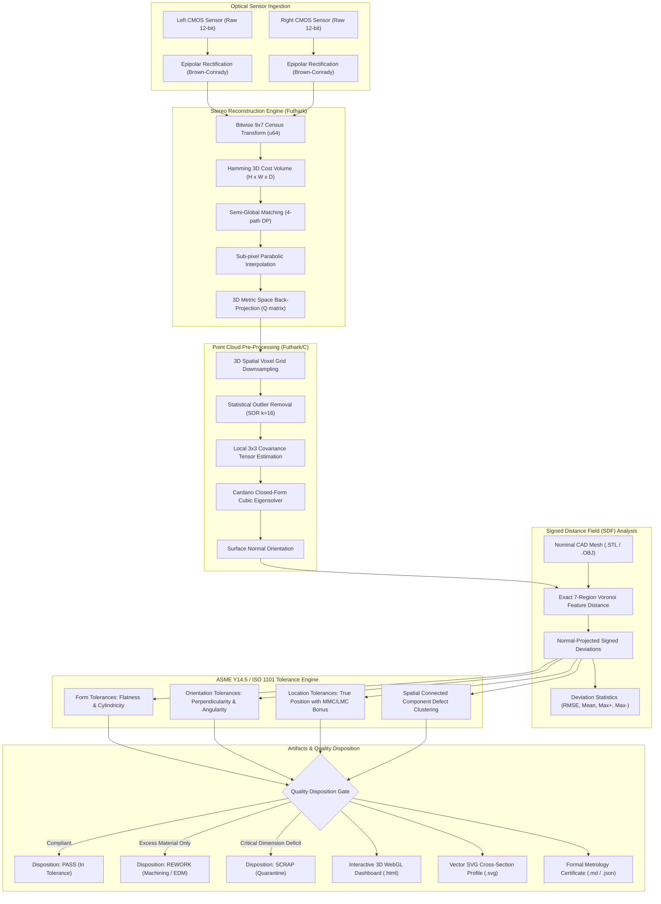
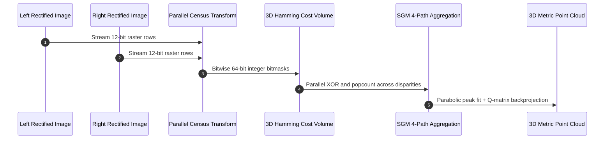
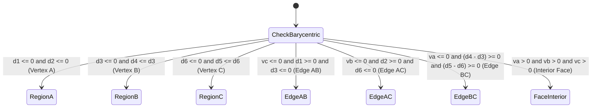
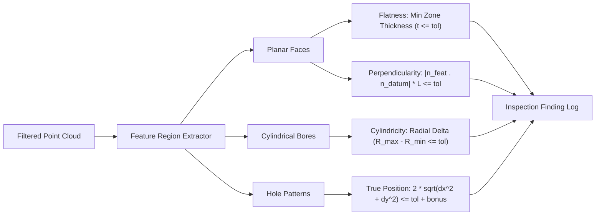

# Caliper Architecture Specification

Caliper is a high-throughput computational metrology, 3D optical inspection, and ASME Y14.5 / ISO 1101 Geometric Dimensioning & Tolerancing (GD&T) platform.

The system is structured as a three-tier architecture:
1. **Parallel Kernel Layer (Futhark)**: Pure data-parallel functional algorithms compiled directly to vectorized C, OpenCL, Apple Metal, or NVIDIA CUDA.
2. **Native Host Bridge Layer (C99)**: Memory-mapped I/O, binary STL/PLY parsers, and zero-copy runtime interfaces.
3. **Metrology Orchestration Layer (Python 3.10+)**: Declarative tolerance rule builders, interactive 3D WebGL dashboard generation, vector SVG slice reporters, and procedural scenario pipelines.

---

## 1. System Hierarchy & Dataflow

---

## 2. Core Subsystems

### 2.1 Optical Sensor Rectification & Calibration (`calib.fut`)
Industrial optical metrology systems utilize high-resolution dual-CMOS sensors. Real-world optics introduce tangential and radial lens distortion governed by the Brown-Conrady 8-parameter polynomial model:

$$x_d = x_u (1 + k_1 r^2 + k_2 r^4 + k_3 r^6) + [2 p_1 x_u y_u + p_2 (r^2 + 2 x_u^2)]$$
$$y_d = y_u (1 + k_1 r^2 + k_2 r^4 + k_3 r^6) + [p_1 (r^2 + 2 y_u^2) + 2 p_2 x_u y_u]$$

Because analytical inversion of higher-order polynomials is ill-posed, Caliper implements a parallel 5-iteration Newton-Raphson contraction mapping kernel. Sub-pixel image resampling uses a 16-tap Catmull-Rom bicubic spline convolution kernel.

### 2.2 Bitwise Census Transform & Semi-Global Matching (`census.fut`, `sgm.fut`)
- **Census Transform**: Uses a $9 \times 7$ rectangular window (63 comparisons). Bit $k$ of a 64-bit unsigned integer is set to 1 if neighbor intensity is strictly less than center intensity. This provides total immunity to non-uniform ambient illumination changes.
- **Cost Volume**: Parallel bitwise XOR followed by population count instruction (`u64.popc`) computes Hamming distance across all $(y, x, d)$ coordinates.
- **Dynamic Programming (SGM)**: Aggregates matching costs along 4 principal cardinal directions ($L_r$ paths) using smoothness penalty parameters $P_1$ (small depth step) and $P_2$ (discontinuous depth boundary).
- **Sub-pixel Refinement**: Fits a local parabola through minimum cost disparity $d^*$ and its neighbors $d^*-1, d^*+1$ to achieve 1/16th pixel depth resolution.

### 2.3 Exact 7-Region Voronoi Signed Distance Field (`distance.fut`)
Computing distances from scanned points to arbitrary CAD meshes requires exact Euclidean projection without voxel grid approximations. For each triangle with vertices $(A, B, C)$ and query point $P$, Caliper classifies $P$ into one of seven Voronoi feature regions:

The projection sign is derived from the inner product between the displacement vector $(P - Q^*)$ and the outward facet unit normal $\hat{n}$.

### 2.4 Cardano Closed-Form Cubic Eigensolver (`normals.fut`)
For normal estimation, Caliper computes the local $3 \times 3$ symmetric covariance tensor $C$:

$$C = \frac{1}{k} \sum_{i=1}^k (p_i - \bar{p})(p_i - \bar{p})^T$$

Rather than utilizing iterative QR decomposition (which causes variable execution divergence on SIMD/GPU hardware), Caliper solves the cubic characteristic polynomial $\det(C - \lambda I) = 0$ via closed-form trigonometric Cardano equations:

$$p_1 = C_{01}^2 + C_{02}^2 + C_{12}^2$$
$$q = \frac{\text{tr}(C)}{3}, \quad p = \frac{1}{6} \left( \|C - q I\|_F^2 \right)$$
$$\phi = \frac{1}{3} \arccos\left(\text{clamp}\left(\frac{\det(C - q I)}{2 p^{3/2}}, -1, 1\right)\right)$$

The eigenvalues satisfy:
$$\lambda_1 = q + 2 \sqrt{p} \cos(\phi)$$
$$\lambda_3 = q + 2 \sqrt{p} \cos\left(\phi + \frac{2\pi}{3}\right)$$
$$\lambda_2 = 3 q - \lambda_1 - \lambda_3$$

The surface normal $\hat{n}$ corresponds to the eigenvector of minimal eigenvalue $\lambda_3$, oriented towards the optical sensor origin.

---

## 3. ASME Y14.5 / ISO 1101 GD&T Tolerancing Subsystem

### 3.1 Material Condition Modifiers (MMC and LMC)
For features of size (e.g. cylindrical pin bores or bolt holes), Caliper implements ASME Y14.5 Maximum Material Condition (MMC) bonus tolerances:

$$\text{Bonus} = \max(0, \text{Actual Diameter} - \text{MMC Diameter})$$
$$\text{Total Tolerance} = \text{Base Tolerance} + \text{Bonus}$$

This bonus tolerance expands the allowable cylindrical position boundary without compromising mechanical assembly clearances.

---

## 4. Hardware Acceleration and Portability

Caliper targets high-throughput execution across heterogeneous compute platforms:

| Target Architecture | Compiler Backend | Acceleration Strategy |
| :--- | :--- | :--- |
| Apple Silicon (M1/M2/M3/M4) | Clang / LLVM | ARM NEON 128-bit SIMD vectorization |
| x86_64 High-End Desktop | Clang / GCC | AVX2 / FMA 256-bit SIMD vectorization |
| Discrete GPUs (AMD / Intel) | Futhark OpenCL | Parallel 2D workgroup dispatch |
| Apple Metal Compute | Futhark C + Metal Bridge | Metal Shading Language (MSL) compute pipelines |
| Discrete GPUs (NVIDIA) | Futhark CUDA | Warp-synchronous reductions and shared memory |

### Zero-Copy Native Bridge
Data exchanged between Python and native C/Futhark runtimes resides in contiguous memory buffers (`float32` / `float64`). Array shapes, strides, and memory layouts are strictly uniform, eliminating serialization overhead.
