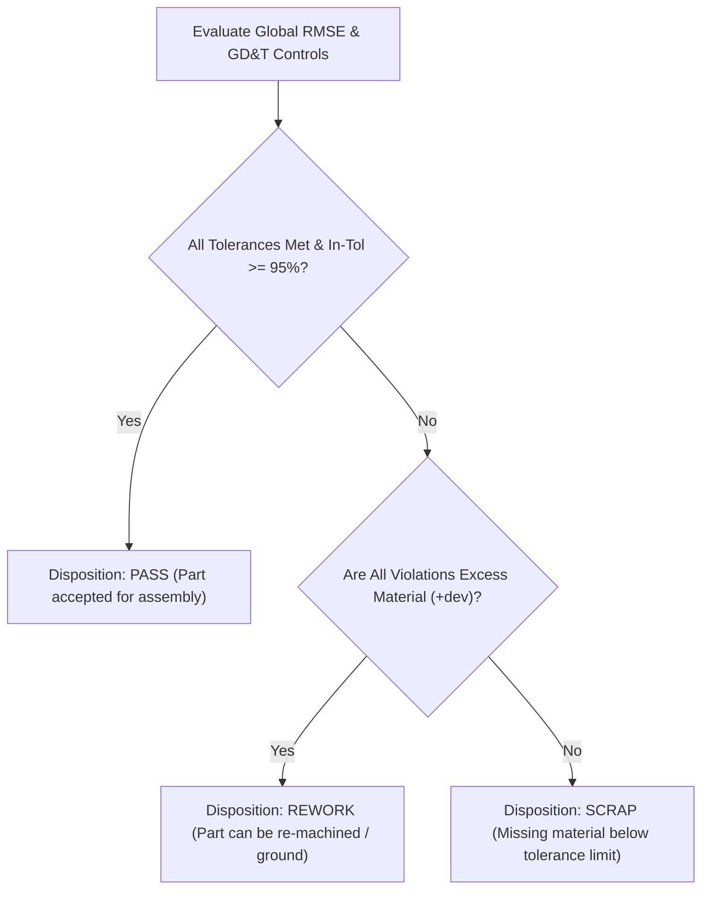

# ASME Y14.5 & ISO 1101 GD&T Specification Guide

Caliper implements automated compliance auditing according to the ASME Y14.5-2018 (American National Standard) and ISO 1101:2017 (International GPS Standard) specifications.

---

## 1. Supported Geometric Characteristic Controls

| Symbol | Characteristic | Standard | Tolerance Type | Datum Required | Mathematical Formulation |
| :---: | :--- | :--- | :--- | :---: | :--- |
| ⏥ | Flatness | ASME Y14.5 Sec 8.4 | Form | No | $t = \max(z_i) - \min(z_i) \le t_{\text{spec}}$ |
| ○ | Circularity / Roundness | ASME Y14.5 Sec 8.4 | Form | No | $t = R_{\max} - R_{\min} \le t_{\text{spec}}$ |
| ⌭ | Cylindricity | ASME Y14.5 Sec 8.4 | Form | No | $t = \max_i(r_i) - \min_i(r_i) \le t_{\text{spec}}$ |
| ⟂ | Perpendicularity | ASME Y14.5 Sec 9.4 | Orientation | Yes | $t = \|\hat{\mathbf{n}}_{\text{feat}} \cdot \hat{\mathbf{n}}_{\text{datum}}\| \cdot L \le t_{\text{spec}}$ |
| ∠ | Angularity | ASME Y14.5 Sec 9.4 | Orientation | Yes | $t = |\cos(\theta_{\text{meas}}) - \cos(\theta_{\text{nom}})| \cdot L \le t_{\text{spec}}$ |
| ⌖ | True Position | ASME Y14.5 Sec 10.2 | Location | Yes | $2 \sqrt{(\Delta x)^2 + (\Delta y)^2} \le t_{\text{base}} + t_{\text{bonus}}$ |
| ⌒ | Profile of a Line | ASME Y14.5 Sec 11.2 | Profile | Optional | $\max_i |d_i| \le \frac{1}{2} t_{\text{spec}}$ |
| ⌓ | Profile of a Surface | ASME Y14.5 Sec 11.2 | Profile | Optional | $\max_i |d_i| \le \frac{1}{2} t_{\text{spec}}$ |

---

## 2. Tolerance Zone Evaluation Methods

### 2.1 Form Tolerances

#### Flatness (ASME Y14.5 Sec 8.4.1)
Flatness is that condition of a surface having all elements in one plane. An actual surface must lie within a tolerance zone bounded by two parallel planes separated by the specified tolerance value $t$.
- **Least-Squares Plane Method**: Fits plane $z = ax + by + c$ minimizing $\sum (z_i - ax_i - by_i - c)^2$.
- **Peak-to-Valley Thickness**: Evaluates the distance between the highest positive peak and lowest negative valley normal to the reference plane:
  $$t_{\text{flatness}} = \max_i (\mathbf{p}_i \cdot \hat{\mathbf{n}}) - \min_i (\mathbf{p}_i \cdot \hat{\mathbf{n}})$$

#### Cylindricity (ASME Y14.5 Sec 8.4.4)
Cylindricity is a condition of a surface of revolution in which all points of the surface are equidistant from a common axis. The tolerance zone is bounded by two coaxial cylinders separated by radial distance $t$.
- **Orthogonal Distance Regression (ODR)**: Solves for optimal cylinder centerline axis $\mathbf{a}$ and origin $\mathbf{c}$ minimizing:
  $$E(\mathbf{c}, \mathbf{a}, R) = \sum_{i=1}^N \left( \|(\mathbf{p}_i - \mathbf{c}) - ((\mathbf{p}_i - \mathbf{c}) \cdot \hat{\mathbf{a}})\hat{\mathbf{a}}\| - R \right)^2$$
- **Cylindricity Metric**:
  $$t_{\text{cyl}} = \max_i(r_i) - \min_i(r_i)$$

---

### 2.2 Orientation Tolerances

#### Perpendicularity (ASME Y14.5 Sec 9.4.2)
Perpendicularity is the condition of a surface, feature center plane, or feature axis at a right angle (90 degrees) to one or more datum planes or axes.
- For a planar feature with unit normal $\hat{\mathbf{n}}_{\text{feat}}$ relative to datum plane with unit normal $\hat{\mathbf{n}}_{\text{datum}}$:
  $$|\hat{\mathbf{n}}_{\text{feat}} \cdot \hat{\mathbf{n}}_{\text{datum}}| = 0 \quad (\text{ideal perpendicularity})$$
- The projected linear angular variation over feature length $L$ is:
  $$\Delta_{\text{perp}} = |\hat{\mathbf{n}}_{\text{feat}} \cdot \hat{\mathbf{n}}_{\text{datum}}| \cdot L$$

---

### 2.3 Location Tolerances & Material Condition Modifiers

#### True Position (ASME Y14.5 Sec 10.2)
A positional tolerance defines a zone within which the center, axis, or center plane of a feature of size is permitted to vary from its true (theoretically exact) basic position.

For a cylindrical hole at nominal location $(x_{\text{nom}}, y_{\text{nom}})$ with measured actual center $(x_{\text{act}}, y_{\text{act}})$:
$$\text{Radial Offset } \delta r = \sqrt{(x_{\text{act}} - x_{\text{nom}})^2 + (y_{\text{act}} - y_{\text{nom}})^2}$$
$$\text{Actual Diametral Position Deviation } D_{\text{pos}} = 2 \cdot \delta r$$

#### Maximum Material Condition (MMC)
When specified with the MMC modifier (circled M symbol), bonus tolerance is granted as the actual produced feature deviates from its maximum material size:

- **Internal Feature of Size (Hole / Bore / Pocket)**:
  - MMC occurs at the **smallest** allowable hole diameter ($D_{\text{min}}$).
  - As the hole is manufactured larger, more clearance is available.
  - $\text{Bonus Tolerance } t_{\text{bonus}} = \max(0.0, D_{\text{actual}} - D_{\text{MMC}})$.

- **External Feature of Size (Pin / Shaft / Boss)**:
  - MMC occurs at the **largest** allowable shaft diameter ($D_{\text{max}}$).
  - $\text{Bonus Tolerance } t_{\text{bonus}} = \max(0.0, D_{\text{MMC}} - D_{\text{actual}})$.

$$\text{Total Permissible Position Tolerance } t_{\text{total}} = t_{\text{base}} + t_{\text{bonus}}$$

$$\text{Compliance Condition: } D_{\text{pos}} \le t_{\text{total}}$$

---

## 3. Automated Quality Disposition Decision Matrix

Caliper evaluates all inspection findings through a deterministic gate:

1. **PASS**: 100% of specified GD&T checks pass, $\ge 95\%$ of surface scan points fall within the bilateral profile tolerance, and global RMSE is within acceptable process capability limits.
2. **REWORK**: Out-of-tolerance regions consist solely of excess material (positive deviation blisters, burrs, flash, or undersized hole diameters that can be remachined or ground to size).
3. **SCRAP**: Part exhibits material deficits (voids, porosity, cavitation, or oversized holes) below the lower specification limit that cannot be recovered through subtractive manufacturing.
